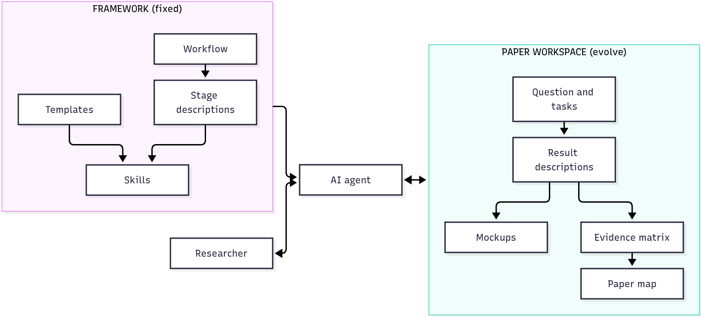
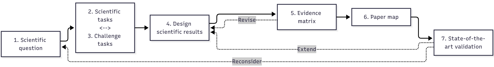

# Paper design framework

this is framework of the subsequent process of executing the research and writing actual paper. Here we assume entrire paper process falls into three phase: reserarch design, reserarch execution and research description (writing). 

**Phase A — Research design:** Scientific question → Tasks → Planned results → Evidence matrix → Paper map → Literature validation

**Phase B — Research execution:** Experiments → Actual results → Evaluation → Revision of results and paper map (iterative process)

**Phase C — Scientific writing:** prewriting, field review, writing, editing. Verified findings → Scientific conclusions → Narrative → Manuscript

Current framework is devoted to **Phase A**

**The central principle of the entire approach is that we design the scientific argument before writing the paper and even performing real experiment. We assume it allows understand do we plan enough results (evidences) to constitute a paper.**

This is, in effect, a form of **evidence-driven scientific paper development**: the result descriptions serve as specifications, the evidence matrix serves as a completeness check, and the paper map serves as the architecture of the scientific argument.

## How to use framework

While you can make everything manually using workflow files, this workflow is designed to be used by Agents via skills. The AI reads the framework, determines the current stage from the workspace state, uses the appropriate skill, interacts with the researcher when necessary, and modifies the paper-specific artifacts.

It should never modify the framework as a side effect of designing a paper. However if you want intentionally change somithing that you think would work better for you fill free to update framework. We still recommend avoid mixing framework modification and paper design.

## Paper design workflow

Below is overall sequence of stages, transitions, and feedback loops for paper desing.

