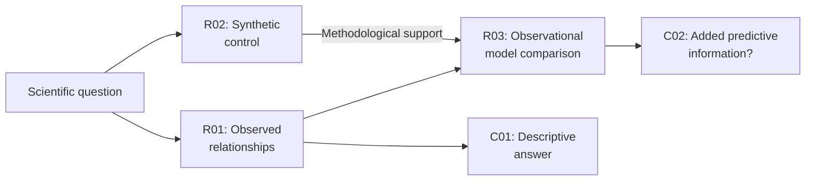

# Mock research scenario: Global electron content and solar activity

**Scenario ID:** `gec-solar-activity-demo`  
**Type:** Guided tutorial / mock paper design  
**Location:** `examples/mock-research-scenario.md`
**Purpose:** Demonstrate all seven stages of the scientific paper-design workflow using one small, deliberately non-novel investigation. This is a training scenario, not a publication proposal. No observational analysis is claimed to have been performed.

## 0. Instructions for the agent

Use this scenario only as an optional teaching aid when the researcher has no scientific idea yet, struggles to formulate a task or result, or explicitly asks for an example of the workflow. Do not impose this scenario on a researcher who already has a direction.

### Entry and interaction rules

1. Offer a choice: work on the researcher's own idea, or explore this short example. Explain that the example demonstrates the process, not a novel scientific discovery.
2. If the researcher chooses the example, follow the seven stages in `workflow.md`, using the corresponding stage descriptions, skills, and templates. The contents below are the fixed reference scenario, not a replacement for the framework.
3. Present only the current stage initially. Briefly explain its purpose, show the proposed example, and ask one useful question. Allow the researcher to accept the default, discuss it, or revise it. Do not reveal all later answers unless asked for a complete walkthrough.
4. If the researcher accepts the default, use the exact scenario question, task IDs, result IDs, relationships, mockup layouts, and reference set below. Do not randomly invent alternative scientific cases or numerical findings. Use the same example when demonstrating any individual stage.
5. After agreement to create a demo workspace, initialize `papers/gec-solar-activity-demo/` using the normal templates. Record `mode: demo` and `scenario: gec-solar-activity-demo` in `workspace.yaml` if compatible with the workspace schema; otherwise record the mode in `question.md` and the state using the normal schema. Update the workspace after each accepted stage. The framework and this example file are read-only during paper development.
6. **Researcher override:** At any stage, if the researcher provides their own idea, scientific question, task, result vision, or other direction for their actual paper, stop applying the default scenario. Follow their instructions and the normal framework. Do not inject the default GEC tasks, results, mockups, or literature into their research. Retain only prior material that they explicitly want to reuse. If switching from a demo to a real paper, preserve the demo workspace separately and create or select the real paper workspace with the researcher; do not silently overwrite it. If a user is only asking to modify the example as an exercise, continue in demo mode.
7. If the researcher is unsure at a later stage of their own paper, explain the analogous step using this example separately, and then return to their own paper. Never fill gaps in their real paper with scenario-specific defaults.
8. Keep scientific statements conditional until actual evidence is obtained. All mockups must be labeled `ILLUSTRATIVE MOCKUP — NOT OBSERVATIONAL EVIDENCE`. Do not download data, run a research experiment, or write a manuscript unless the researcher requests it. The optional synthetic control described below is a planned experiment, not an executed one.

Suggested opening:

> We can start with your own scientific idea, or walk through a small example: how global ionospheric electron content varies with solar radio flux and sunspot number. The example takes us through all seven stages, including result mockups and literature validation. It is intended for learning, not publication. Which would you prefer?

## Stage 1. Define the scientific question

**Output:** `question.md`, `terminology.md`

### 1a. Starting idea and idea grilling

Use this informal idea as the starting point:

> Global electron content (GEC) follows solar radiation, represented by F10.7, but also follows sunspot number. Perhaps this indicates a connection between sunspots and solar radiation.

Guide the researcher through the following distinctions, one at a time if discussing interactively:

- F10.7 measures solar radio emission at 10.7 cm. It is a proxy for ionizing solar extreme ultraviolet (EUV) radiation, not the radiation responsible for ionizing the upper atmosphere.
- GEC may correlate with both F10.7 and sunspot number because both indices reflect solar activity. Two correlations with GEC alone do not establish causation or independent effects. A direct comparison of the indices is necessary to assess their statistical association.
- If the indices are strongly correlated, adding sunspot number to an F10.7-based model may or may not improve its ability to describe or predict GEC. This is a useful question beyond simply plotting two correlations.
- The basic relationships are already established in the literature. Reproducing them is suitable for this tutorial, but is not by itself a novel contribution.

**Working title:** Global ionospheric electron content in relation to F10.7 and sunspot number: a demonstration study.

**Scientific question:** How does monthly global electron content vary with F10.7 and international sunspot number, and does sunspot number provide additional predictive information about GEC beyond F10.7?

**Motivation:** Compare two accessible indicators of solar activity, understand their relationship to global ionospheric variability, and learn how to distinguish association from incremental predictive information.

**Scope (fixed tutorial defaults):**

- Monthly means, January 2000–December 2019; global, not regional, electron content. This interval includes multiple solar activity phases and solar cycle 24.
- Use a consistent GEC series derived from one GIM product (e.g., CODE). If calculating GEC, use area-weighted integration of vertical TEC with a documented, fixed effective-shell convention and unit conversion; use a published series if available instead.
- Use adjusted F10.7 (normalized to 1 AU) consistently as a solar activity proxy, and monthly international sunspot number (SILSO version 2.0). Align all series by calendar month and use common available months. Record missingness; do not silently interpolate gaps.
- Monthly mean Ap and annual/semiannual seasonal terms are common baseline controls for the illustrative predictive comparison. No detailed storm or solar EUV analysis is required in this demo.
- No real data are supplied by this file. Availability and consistency of the selected GEC, F10.7 and Ap products must be verified if the researcher later requests actual execution.

**Feasibility:** The investigation can be designed using time series, scatter plots, simple correlations, and a small regression comparison. The design is compact enough for a short tutorial.

### 1b. Gain context through terminology

Use the following three fixed representative papers. Consult their actual text/abstracts when needed; the summaries below are orientation, not quotations.

- S01 — Afraimovich, E. L., et al. (2008). Global electron content: a new conception to track solar activity. *Annales Geophysicae*, 26, 335–344. https://doi.org/10.5194/angeo-26-335-2008
- S02 — Tapping, K. F. (2013). The 10.7 cm solar radio flux (F10.7). *Space Weather*, 11, 394–406. https://doi.org/10.1002/swe.20064
- S03 — Clette, F., Svalgaard, L., Vaquero, J. M., & Cliver, E. W. (2014). Revisiting the sunspot number: A 400-year perspective on the solar cycle. *Space Science Reviews*, 186, 35–103. https://doi.org/10.1007/s11214-014-0074-2

| Term | Definition / distinction | Relevance | Source |
|---|---|---|---|
| TEC | Electron column density, usually expressed in TECU (10^16 electrons per square metre). | Input quantity for estimating GEC. | S01 |
| GEC | Global estimate of the electron population represented by ionospheric TEC, expressed in electrons; the exact estimate depends on the integration convention. | Target variable. | S01 |
| F10.7 | Solar radio flux density at 2.8 GHz (10.7 cm), expressed in solar flux units; commonly used as a solar activity and EUV proxy. | First explanatory variable. | S02 |
| Solar EUV | Extreme ultraviolet solar radiation contributing to atmospheric photoionization. Not equivalent to F10.7. | Physical context for the GEC response. | S01, S02 |
| International sunspot number (SN) | Standardized index of sunspot and sunspot-group counts. It is not a radiation measurement. | Second explanatory variable. | S03 |
| Solar cycle | Approximately 11-year variation in solar activity. | Shared long-term variability can inflate apparent associations. | S01, S03 |
| Incremental predictive information | Improvement in prediction on unseen data when a variable is added to an otherwise identical model. | Distinguishes redundancy from useful additional information. | Tutorial statistical definition |

Data source pointer for SN: WDC-SILSO, Royal Observatory of Belgium, https://sidc.be/SILSO/datafiles. Check product metadata and attribution before use. F10.7 and Ap should come from documented, consistent archives; choosing a specific file is deferred until execution.

**Grilling prompt:** If GEC follows both indices, does this establish two independent influences, or might both be indicators of the same underlying solar variability?

**Default decision:** It establishes neither independent influences nor causation. Keep the scientific question above and test incremental predictive value separately.

**Completion:** The researcher understands the question, the proxy distinction, and why this is a demonstration rather than a novelty claim.

## Stage 2. Develop scientific tasks

**Output:** `tasks.md`

| ID | Scientific task / question | Contribution | Initial status |
|---|---|---|---|
| T01 | How does GEC vary with F10.7? | Characterize the conventional proxy relationship. | Proposed |
| T02 | How does GEC vary with sunspot number? | Characterize the second proxy relationship. | Proposed |
| T03 | How closely do F10.7 and sunspot number vary together? | Identify shared solar variability directly. | Proposed |
| T04 | Which index has the stronger descriptive association with GEC in the selected period? | Compare the two proxies on an identical sample. | Proposed |
| T05 | Does sunspot number improve prediction of GEC beyond F10.7? | Test whether its association is informative beyond the first proxy. | Proposed |
| T06 | Do the relationships change on the approximately 27-day solar rotation timescale? | Explore timescale dependence beyond monthly variability. | Proposed |

**Grilling prompt:** Which of these tasks would you keep if the paper could contain only two or three main results?

**Completion:** All tasks have a clear relationship to the initial question or a plausible extension of it. Do not design individual figures yet.

## Stage 3. Challenge the tasks

**Output:** revised `tasks.md`

Perform the standard top-down and bottom-up review. Use the following fixed decisions for the default scenario.

| Issue | Decision |
|---|---|
| T01 and T02 alone do not show a relationship between the two solar indices. | Retain T03 and compare them directly. |
| T04 compares marginal associations, not independent contributions. | Keep T04 descriptive and retain T05 as a separate predictive test. |
| Shared solar-cycle trends and serial dependence can inflate correlation and invalidate random train/test splits. | Use the same monthly sample, common controls in model comparisons, and chronological evaluation. Do not infer independent physical effects. |
| T06 is interesting, but the monthly design cannot resolve solar-rotation variations adequately. | Mark T06 as `Intentionally excluded`; preserve the question for a possible follow-up using daily data. |
| Is a causal claim about sunspots necessary? | No. Restrict the question and conclusion to association and predictive information. |

**Reviewed status:** T01–T05 `Accepted`; T06 `Intentionally excluded`.

**Grilling prompt:** If the combined model does not improve prediction, would the study still answer its question?

**Default decision:** Yes. A lack of demonstrated improvement is an informative outcome within this design; it does not prove the indices are physically equivalent.

**Completion:** The accepted tasks can answer the scoped question; the omitted task does not prevent the monthly investigation from doing so.

## Stage 4. Develop individual scientific results

**Outputs:** `results/R01/result.md`, `results/R02/result.md`, `results/R03/result.md`, associated mockups and, if needed, discussion notes.

Use the exact result IDs and mockup layouts below. Each result description follows the four groups and 12 questions in the result-characterization framework. In a live walkthrough, discuss questions point by point rather than simply filling in every answer without the researcher.

### R01 — Shared variability and pairwise relationships (planned observational result)

**Tasks:** T01, T02, T03, T04.

**A. Content**

1. One four-panel figure: aligned standardized monthly time series of GEC, F10.7 and SN, plus three pairwise scatter plots (GEC–F10.7, GEC–SN, F10.7–SN), with Pearson correlation annotations and sample size.
2. How do GEC and the two solar indices covary, and how do their marginal associations compare?
3. The reader should distinguish temporal similarity, pairwise association, and differences between the two GEC–index relationships. Use shared time axes, explicit units on scatter axes, and comparable layouts. No pattern is guaranteed in advance.

**B. Motivation**

4. Observational characterization and motivation for comparing proxy models.
5. Establishes whether the observed series covary and whether a direct F10.7–SN association exists in the sample; supports discussion of common solar activity variability, not causation.
6. Removing the time-series panel obscures temporal context; removing pairwise panels loses direct comparisons. Combine them in one figure rather than separate results.

**C. Sufficiency**

7. Same monthly interval and valid months for all pairs; axis units, Pearson r, n, dates and missing-data handling. Inspect nonlinear behavior; use rank correlation as an optional sensitivity check if warranted.
8. Monthly averaging hides short periods; shared trends, autocorrelation, seasonality, measurement uncertainty and GIM biases can influence apparent associations. F10.7 is only a proxy. Do not treat ordinary independent-sample significance tests as reliable for serial data.
9. Both associations may be strong, one weaker, or relationships may be nonlinear or weak. Each changes the descriptive comparison and motivates the model test differently.
10. Yes for descriptive tasks; it cannot establish incremental predictive value or causality by itself.

**D. Connections**

11. Depends on the definitions and data choices from Stage 1; provides context for R03 and motivates the simulated control R02.
12. Further evaluation of additional predictive information is planned in R03. A direct EUV comparison would require additional observations and is outside the default scope.

**Mockup:** `results/R01/mockup.md` (or render the same four-panel layout as PNG/SVG if requested).

```text
ILLUSTRATIVE MOCKUP — NOT OBSERVATIONAL EVIDENCE

┌─────────────────────────┬─────────────────────────┐
│ (a) Monthly time series │ (b) GEC vs F10.7        │
│ y: standardized value   │ y: GEC                  │
│                         │                         │
│ [GEC, F10.7, SN lines]   │ [scatter; r=?, n=?]     │
│                         │                         │
│ x: 2000–2019            │ x: F10.7 (sfu)          │
├─────────────────────────┼─────────────────────────┤
│ (c) GEC vs SN           │ (d) F10.7 vs SN         │
│ y: GEC                  │ y: F10.7 (sfu)          │
│                         │                         │
│ [scatter; r=?, n=?]     │ [scatter; r=?, n=?]     │
│                         │                         │
│ x: sunspot number       │ x: sunspot number       │
└─────────────────────────┴─────────────────────────┘
```

**Grilling prompt:** Why is the F10.7–SN panel necessary if both GEC scatter plots already show a relationship?

**Default answer:** It directly tests association between the solar indices, which cannot be inferred unambiguously from their separate GEC associations.

### R02 — Controlled example of redundant and informative proxies (planned synthetic result)

**Task:** T05, methodological support only.

**A. Content**

1. One two-case comparison table or diagram showing synthetic proxy pairs and their prediction errors for models with and without the second proxy. The target and proxies are synthetic, dimensionless and are not measurements of GEC or solar activity.
2. Can a second correlated predictor be associated with the target without improving prediction, and can it improve prediction when it contains additional information?
3. The reader should see the distinction between marginal correlation and added predictive information, using two contrasting controlled cases and the same evaluation metric as R03.

**B. Motivation**

4. Methodological illustration and check of the planned model comparison.
5. Helps interpret the observational model comparison in R03. It does not provide evidence of an actual physical solar relationship.
6. Without it, the real-data comparison remains possible, but the tutorial loses a controlled explanation of the statistical issue. For a real paper, it could be moved to supplementary material or omitted with justification.

**C. Sufficiency**

7. Use 240 synthetic monthly points, common chronological split (first 180 training, last 60 testing), and identical predictors and RMSE metric within each case. Example deterministic design: initialize NumPy `default_rng(42)`; let S and U be independent standard-normal draws; draw independent standard-normal noise vectors e1 and e2; set X=S and Z=0.9*S+0.4*U. Case A target Y=1.2*S+0.5*e1; Case B target Y=1.2*S+0.7*U+0.5*e2. Compare intercept+X and intercept+X+Z. Draw in the order S, U, e1, e2 if executing. Do not supply fabricated model scores.
8. This deliberately simplified construction uses independent random samples and exact linear relations; it omits solar-cycle dynamics, time dependence and actual measurement biases. It demonstrates a principle, not realistic solar physics.
9. In the population construction, Z adds no information conditional on X in Case A and does in Case B; finite samples can deviate. If evaluation fails to distinguish the cases, inspect the procedure or sampling variability rather than adjusting outputs to fit expectations.
10. It checks the interpretation of the proposed statistical comparison but cannot answer T05 for the real ionosphere on its own.

**D. Connections**

11. Informed by the shared-proxy question in R01; methodological input to R03.
12. Actual implementation and evaluation would be needed to fill the scores. Real-data confirmation requires R03.

**Mockup:** `results/R02/mockup.md`.

> ILLUSTRATIVE MOCKUP — NOT OBSERVATIONAL EVIDENCE; synthetic experiment not executed.

| Synthetic case | Second proxy | Model X: test RMSE | Model X+Z: test RMSE | Interpretation to check |
|---|---|---|---|---|
| A | Redundant given X | TBD | TBD | No systematic improvement expected |
| B | Additional information | TBD | TBD | Improvement expected |

**Grilling prompt:** Why might two predictors each correlate with the target while the second adds no useful information?

**Default answer:** They may carry overlapping information about the same underlying signal.

### R03 — Incremental predictive value of sunspot number (planned observational result)

**Task:** T05.

**A. Content**

1. A compact table comparing four regression models of monthly GEC; optionally append a common held-out residual or observed-versus-predicted panel if it adds information. The primary artifact is the table.
2. Does adding SN improve out-of-sample prediction beyond F10.7 after applying the same baseline controls?
3. The reader should compare the F10.7-only and combined models directly, distinguish training fit from test performance, and see whether any improvement is consistent with the chosen test design.

**B. Motivation**

4. Principal quantitative test of incremental predictive information.
5. Enables a conditional conclusion on whether SN helps the model in the selected interval, without claiming an independent physical driver.
6. Without R03, the paper answers only descriptive correlation questions; the second part of the main question remains unresolved.

**C. Sufficiency**

7. Use linear regression with a common intercept, monthly mean Ap, and annual/semiannual sine/cosine terms as baseline B. Compare B; B+F10.7; B+SN; B+F10.7+SN. Use January 2000–December 2014 for training and January 2015–December 2019 for held-out evaluation. Fit transformations on training data only; use identical eligible months for all models. Report held-out RMSE (in GEC units), MAE, and paired difference in RMSE between F10.7-only and combined models. Include training/test sample counts, correlation between predictors, and uncertainty using a time-aware approach (e.g., sensitivity to additional chronological splits or a block bootstrap of paired errors). A single held-out interval limits generalization. Prespecify any practical improvement threshold before analyzing data.
8. Proxy collinearity, solar-cycle nonstationarity, nonlinear or lagged responses, and residual confounding can affect interpretation. Linear regression is intentionally simple. Contemporaneous monthly indices make this a held-out reconstruction/nowcasting-style test, not a forecast of future GEC without knowing future inputs.
9. Improvement: SN provides useful additional predictive information for this model and interval. No clear improvement: additional value is not demonstrated. Worse performance: the second proxy may be redundant or unstable in this setup. Mixed outcomes: qualify the conclusion and consider time dependence or model limitations.
10. The design addresses T05 as a predictive question; it cannot establish causal or independent physical effects. T01–T04 provide the descriptive context.

**D. Connections**

11. Depends on the observational sample and context from R01; interpretation is informed by R02. Together the three results answer the scoped main question.
12. Independent time intervals, other GIM products, nonlinear models, or direct EUV measurements could provide additional confirmation; these are outside the compact default scenario unless the researcher chooses to extend it.

**Mockup:** `results/R03/mockup.md`.

> ILLUSTRATIVE MOCKUP — NOT OBSERVATIONAL EVIDENCE; no models have been fitted.

| Model | Predictors | Test RMSE | Test MAE | RMSE change vs B+F10.7 |
|---|---|---|---|---|
| M0 | B | TBD | TBD | TBD |
| M1 | B + F10.7 | TBD | TBD | Reference |
| M2 | B + SN | TBD | TBD | TBD |
| M3 | B + F10.7 + SN | TBD | TBD | TBD |

**Grilling prompt:** If the combined model has a higher training R² but does not reduce held-out error, what can we conclude?

**Default answer:** Better training fit alone does not establish additional predictive value. Report the held-out comparison and its uncertainty.

**Stage 4 completion:** Three result descriptions are agreed upon; the planned figure/table layouts are explicit; mockups contain no invented observational findings. The scenario includes one result covering four tasks and a task investigated through both synthetic and observational results.

## Stage 5. Build the evidence matrix

**Output:** `evidence.md`

| Task | Scientific question | Required evidence | Results | Status |
|---|---|---|---|---|
| T01 | How does GEC vary with F10.7? | Monthly time series and pairwise comparison | R01 | Planned |
| T02 | How does GEC vary with SN? | Monthly time series and pairwise comparison | R01 | Planned |
| T03 | How closely do F10.7 and SN vary together? | Direct comparison of the two solar indices | R01 | Planned |
| T04 | Which index has the stronger descriptive association with GEC? | Comparable association metrics on common months | R01 | Planned |
| T05 | Does SN improve GEC prediction beyond F10.7? | Controlled statistical example and held-out observational model comparison | R02, R03 | Planned |
| T06 | Do the relationships differ at the 27-day timescale? | Daily data and timescale-specific analysis | — | Intentionally excluded |

R02 is methodological support only; R03 is necessary for observational evidence for T05. R01 covers T01–T04 in one figure. T06 remains in the matrix as a conscious scope decision, not a missed essential task. No evidence status is `Supported` until actual analysis is performed.

**Grilling prompt:** If R03 were removed, would all accepted tasks still have sufficient planned observational evidence?

**Default answer:** No. R02 alone cannot establish whether SN improves prediction of real GEC. Retain R03.

**Completion:** All essential tasks have plausible planned evidence, and the intentional exclusion is justified.

## Stage 6. Build the paper map

**Outputs:** `paper-map.yaml`, `paper-map.mmd`

Use the following canonical relationships. They are not manuscript order and do not imply actual findings.

```yaml
paper:
  id: gec-solar-activity-demo
  question: >
    How does monthly global electron content vary with F10.7 and
    international sunspot number, and does sunspot number provide
    additional predictive information about GEC beyond F10.7?
  question_ref: question.md
  tasks_ref: tasks.md
  evidence_ref: evidence.md

results:
  R01:
    title: Shared variability and pairwise relationships
    artifact: results/R01/result.md
    supports: [T01, T02, T03, T04]
    depends_on: []
    justified_by: []
    validated_by: []
    compared_with: []
    synthesizes: []
  R02:
    title: Controlled example of redundant and informative proxies
    artifact: results/R02/result.md
    supports: [T05]
    depends_on: []
    justified_by: []
    validated_by: []
    compared_with: []
    synthesizes: []
  R03:
    title: Incremental predictive value of sunspot number
    artifact: results/R03/result.md
    supports: [T05]
    depends_on: [R01]
    justified_by: [R02]
    validated_by: []
    compared_with: []
    synthesizes: []

conclusions:
  C01:
    question: How do GEC and the two solar indices covary?
    supported_by: [R01]
    actual_claim: null
  C02:
    question: Does SN add predictive information beyond F10.7?
    supported_by: [R03]
    actual_claim: null
```

R02 supports T05 methodologically; it is not listed as observational support for C02. R03 reuses the common observational sample and is informed by the synthetic comparison. `justified_by` describes methodological support, not independent validation of real measurements.



**Grilling prompt:** Which result could be obtained independently of the observational data, and which conclusion would it not establish by itself?

**Default answer:** R02 can be developed independently, but cannot establish the actual relationship between GEC and the solar proxies.

**Completion:** The logical dependencies and contributions to the two planned answers are explicit; actual claims remain null.

## Stage 7. Validate against the state of the art

**Output:** `literature/state-of-the-art.md`

The normal workflow calls for a deep literature search. For this teaching scenario, use a small, fixed, real reference set so every researcher sees the same example. This is a bounded demonstration of literature validation, not an exhaustive search or a verified novelty assessment. If the researcher explicitly requests an actual deep search, conduct it using the normal literature-validation skill and document its scope.

### Search plan to demonstrate

- Search for `"global electron content" "F10.7" solar activity`, `"global electron content" sunspot number`, `"F10.7" sunspot number relationship`, and `"global electron content" EUV solar rotation`.
- In a live search, use NASA ADS, scholarly search tools, and publisher pages; record search date, queries, inclusion criteria and inspected sources. Include relevant peer-reviewed observational, proxy, and modeling studies; distinguish direct evidence from papers providing background only.
- Start with S01–S03 from Stage 1 and the following two additional papers:
  - S04 — Tapping, K. F., & Valdés, J. J. (2011). Did the Sun change its behaviour during the decline of cycle 23 and into cycle 24? *Solar Physics*, 272, 337–350. https://doi.org/10.1007/s11207-011-9827-1
  - S05 — Chen, Y., Liu, L., Le, H., & Zhang, H. (2015). Discrepant responses of the global electron content to the solar cycle and solar rotation variations of EUV irradiance. *Earth, Planets and Space*, 67, 80. https://doi.org/10.1186/s40623-015-0251-x

### Example positioning document

| Task / result | Existing research | Our proposed demonstration | Implication |
|---|---|---|---|
| T01 / R01 | S01 examines GEC responses to solar EUV and F10.7 and identifies solar-cycle and rotation-related variability. | Reproduce a monthly descriptive comparison. | Established research; no novelty claim. |
| T02–T04 / R01 | S02 and S04 establish that F10.7 and sunspot number are related solar indices; S04 examines changes in their relationship across solar-cycle phases. These references do not, by themselves, establish the GEC–SN relation for our sample. | Compare all three series on identical monthly coverage. | Retain as a tutorial exercise; do not claim discovery of the solar-index connection. |
| T05 / R02, R03 | S02 explains limitations of F10.7 as an EUV proxy; S04 shows that the relationship between the two indices can change. Neither reference is evidence of incremental GEC prediction in the proposed model. | Compare one- and two-proxy models using held-out months, with a controlled synthetic illustration. | The specific empirical answer remains unknown here. Broader literature would be required to assess novelty. |
| T06 / excluded | S05 studies differences in GEC response to EUV variability on solar-cycle and solar-rotation timescales. | Not investigated with monthly data. | Retain as an intentional omission; mention timescale dependence as a limitation. |

**Research gap and novelty:** The example intentionally revisits established solar–ionosphere relationships. No research gap is asserted. The fixed sources justify the teaching question but cannot establish that the planned predictive comparison is new.

**Methodological implication:** Distinguish radio flux from ionizing EUV, consider nonstationarity and shared solar trends, and use out-of-sample evaluation before interpreting additional proxy information. Retain the monthly scope.

**Recommended changes:** No mandatory change to the default tutorial map. If the aim changes to publication, return to Stage 1, conduct a substantially broader literature review, and formulate a defensible research gap before proceeding.

**Grilling prompt:** Is showing that GEC correlates with F10.7 and SN enough for a novel scientific paper?

**Default answer:** No. Much of the underlying relationship is established; a publication would require a justified new question or contribution and a broader literature assessment.

**Completion:** The researcher understands how literature validation affects the question, methods, novelty, and paper map. The demo blueprint is complete; no experiments, new scientific findings, or publication-ready claims are implied.

## End of tutorial

A completed demonstration workspace should contain:

```text
papers/gec-solar-activity-demo/
├── workspace.yaml
├── question.md
├── terminology.md
├── tasks.md
├── results/
│   ├── R01/
│   │   ├── result.md
│   │   └── mockup.md
│   ├── R02/
│   │   ├── result.md
│   │   └── mockup.md
│   └── R03/
│       ├── result.md
│       └── mockup.md
├── evidence.md
├── paper-map.yaml
├── paper-map.mmd
└── literature/
    └── state-of-the-art.md
```

Use the framework templates when creating these artifacts. The workspace state should mark the seven design stages complete only after the researcher accepts their outputs; result status remains planned and actual findings remain empty. Do not create an actual manuscript as part of this example.

Ask the researcher whether they would like to start their own paper using the same process. If they do, switch out of demo mode as specified in Section 0. The real paper must be guided by their idea and decisions, not this scenario.

The lesson: a scientific paper map specifies the evidence needed to answer a question, not what the evidence must show.
