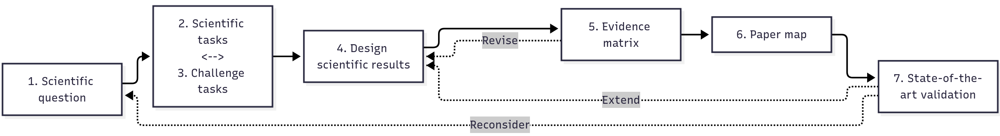
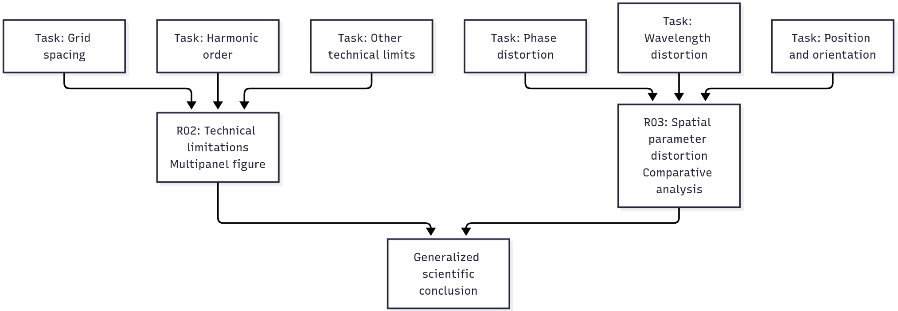
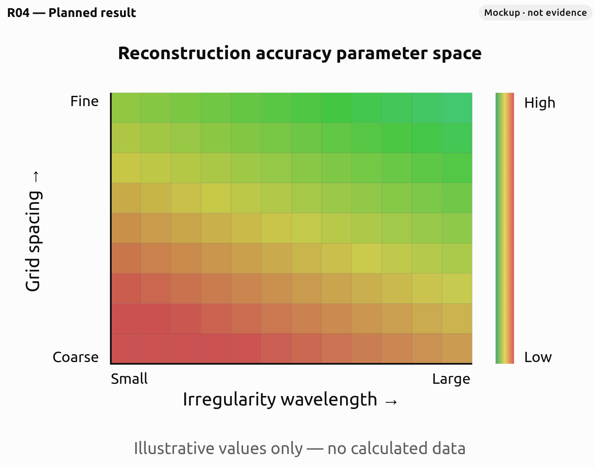
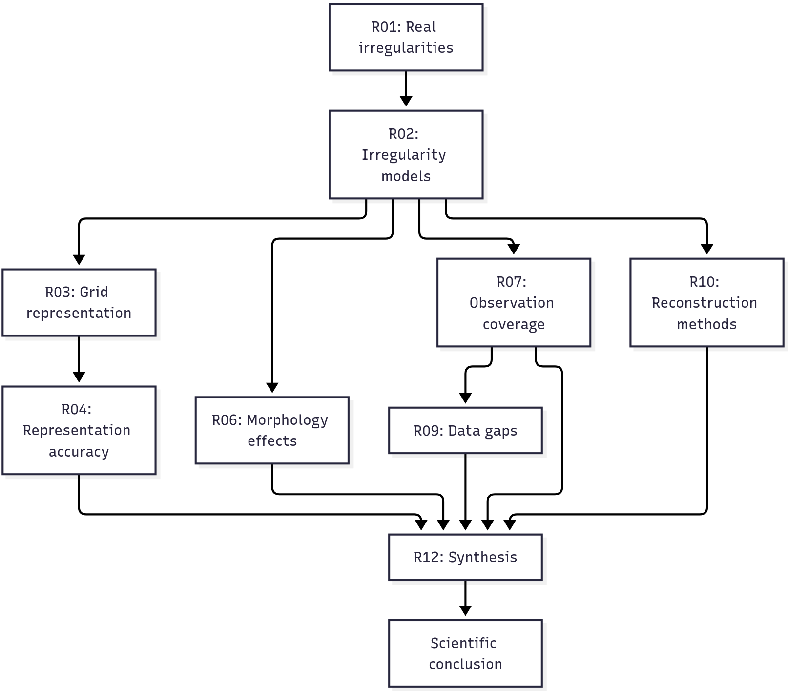

# Paper design workflow 

This workflow transforms the idea of a scientific paper map into a complete **research design**, where each step produces a persistent artifact that can be reviewed, challenged, and refined before moving forward. By complete here we mean obtain enough interconnected results-mockups those when implemented would make research publishable.

We use AI in several different roles: as a domain explorer, a critical reviewer, a research designer, and an assistant for constructing scientific artifacts.

## **1. Overall workflow**

The workflow moves from an initial scientific idea to a **execution-ready blueprint of the paper**, without requiring that any scientific results have already been obtained. 

For guided examples, use the consistent [mock research scenario](examples/mock-research-scenario.md), following the example guidance in `AGENTS.md`.

## **2. Detailed description of the stages**

| Stage                    | Main activity                                                               | Output                                 |
| ------------------------ | --------------------------------------------------------------------------- | -------------------------------------- |
| 1. Scientific question   | Define, challenge, and contextualize the research idea                      | `question.md`, `terminology.md`        |
| 2. Scientific tasks      | Decompose the question into answerable scientific tasks                     | `tasks.md`                             |
| 3. Task review           | Challenge completeness, relevance, and feasibility                          | Revised `tasks.md`                     |
| 4. Result design         | Specify individual results, challenge their design, and create placeholders | `results/RXX.md`, figure/table mockups |
| 5. Evidence matrix       | Establish correspondence between scientific questions, claims, and evidence | `evidence.md`                          |
| 6. Paper map             | Establish logical relationships between results                             | `paper-map.yaml`, `paper-map.mmd`      |
| 7. Literature validation | Place the proposed investigation in the context of existing research        | `state-of-the-art.md`                  |

### **Stage 1. Define the scientific question**

**Purpose:** Establish what we want to investigate and whether the investigation is scientifically meaningful. The initial formulation does not need to be perfect. It should be sufficiently clear to allow critical discussion. It is good idea to get scientific question from you adviser due to the expertise adviser has.

**1a. Grill the idea**

If idea needs verification the AI could act as a critical scientific colleague and challenges the proposed idea.

Possible questions:

- What do we actually want to learn?
- Why is this scientifically interesting?
- Is the answer already obvious from existing theory or known results?
- Is the proposed investigation sufficiently different from existing studies?
- What would change in our understanding of the phenomenon if we answered this question?
- Is the question answerable using available observational data or numerical experiments?

At this stage, a preliminary literature search can be used to identify obvious duplication, established knowledge, and potentially important references.

**1b. Gain context through terminology**

For unfamiliar topics, select approximately three representative papers and extract the domain-specific knowledge needed to formulate the investigation correctly.

The terminology document should contain more than a glossary. It should include:

| Element                   | Example                                                                               |
| ------------------------- | ------------------------------------------------------------------------------------- |
| Term                      | Spatial resolution                                                                    |
| Definition                | Ability to distinguish spatially separated structures                                 |
| Related concepts          | Grid spacing, effective resolution, spectral bandwidth                                |
| Important distinction     | Grid spacing does not necessarily determine effective resolution                      |
| Relevance to our question | We should distinguish representation on a grid from reconstruction using observations |
| Sources                   | References supporting these distinctions                                              |

This is particularly valuable because proper terminology allow you to ask right questions.

**Output:** `question.md` and, when needed, `terminology.md`.

**Completion criterion:** We can clearly explain what we want to investigate, why it matters, and why the answer is not already sufficiently established.

### **Stage 2. Develop scientific tasks**

**Purpose:** Decompose the overall scientific question into smaller, independently answerable questions.

For example:

> **Scientific question:** What determines the ability of Global Ionospheric Maps to reproduce different types of ionospheric irregularities?

The scientific tasks could be:

| ID  | Scientific task                                                                                                                             |
| --- | ------------------------------------------------------------------------------------------------------------------------------------------- |
| T01 | Establish the characteristic morphologies, spatial scales, and amplitudes of real ionospheric irregularities.                               |
| T02 | Determine the relationship between GIM grid spacing and the ability to represent irregularities of different spatial scales.                |
| T03 | Determine whether irregularities with identical characteristic scales but different morphologies are reconstructed with different accuracy. |
| T04 | Determine how the spatial distribution of GNSS observations affects reconstruction quality.                                                 |
| T05 | Investigate whether gaps in observational coverage produce artificial structures or distortions of real irregularities.                     |
| T06 | Determine how the choice of reconstruction method affects the representation of irregularities.                                             |
| T07 | Establish whether the dependencies obtained from numerical experiments are consistent with real observations.                               |

At this stage, we deliberately avoid specifying figures, implementation details, and particular algorithms unless they are essential to formulating the scientific task.

**Output:** `tasks.md`.

**Completion criterion:** Each task addresses a specific aspect of the scientific question and has a potentially identifiable answer.

### **Stage 3. Grill the list of scientific tasks**

**Purpose:** Determine whether the proposed tasks are necessary and collectively sufficient.

Here, I would introduce two complementary reviews.

**Top-down review:** Starting from the scientific question, determine whether every important aspect is addressed by at least one task.

**Bottom-up review:** Starting from each task, determine whether its answer would actually contribute to answering the scientific question.

For example, an AI reviewer might challenge the initial list:

| Observation                                                              | Consequence                                                                                                    |
| ------------------------------------------------------------------------ | -------------------------------------------------------------------------------------------------------------- |
| Grid spacing and effective spatial resolution are treated as equivalent. | Introduce separate experiments for grid representation and reconstruction from observations.                   |
| Tasks investigate spatial characteristics but ignore temporal evolution. | Consider adding a task on temporal resolution or explicitly restricting the study to instantaneous structures. |
| Reconstruction accuracy is investigated without defining accuracy.       | Introduce criteria for amplitude, morphology, position, and detectability.                                     |
| Only synthetic structures are considered.                                | Introduce observational validation or limit the scope of the conclusion.                                       |
| T04 and T05 partially overlap.                                           | Clarify their distinction or combine them.                                                                     |

The grilling stage should identify issues, but the researcher should decide how to resolve them.

**Output:** Revised `tasks.md`, optionally accompanied by a record of accepted and rejected suggestions.

**Completion criterion:** If all tasks are successfully addressed, we expect to be able to answer the original scientific question within clearly defined limitations.

### **Stage 4. Develop individual scientific results**

**Purpose:** Transform the list of scientific tasks into a compact set of scientific results that collectively provide the evidence necessary to answer the research question.

At this stage, we move from the **decomposition of the scientific question** to the **composition of scientific results**.

Since the volume of a scientific paper is limited, we should aim to combine several related scientific tasks into a single meaningful result, rather than developing a separate figure or table for each task.

A result should represent a coherent scientific contribution, potentially addressing several questions through a single multipanel figure, table, or combination of complementary artifacts. The individual aspects of the investigation should be reflected in the description of the result.

For example, for a paper investigating the ability of GIMs to reproduce ionospheric irregularities:

| Result                                                                      | Scientific tasks addressed                                                                                                                                                                                                                                      | Expected representation                                                                                                                                               |
| --------------------------------------------------------------------------- | --------------------------------------------------------------------------------------------------------------------------------------------------------------------------------------------------------------------------------------------------------------- | --------------------------------------------------------------------------------------------------------------------------------------------------------------------- |
| **R01. Characteristics of real ionospheric irregularities**                 | What types of irregularities exist? What are their characteristic scales, amplitudes, and morphologies? Which structures should be considered in numerical experiments?                                                                                         | Series of observational maps accompanied by a table of characteristic parameters.                                                                                     |
| **R02. Influence of technical limitations on irregularity representation**  | How does grid spacing affect the representation of irregularities? How does the maximum order of spherical harmonics influence resolution? How do other technical limitations of GIM representation affect the original structure?                              | Multipanel figure comparing original structures with their representations under different technical constraints, accompanied by quantitative measures of distortion. |
| **R03. Distortion of spatial parameters of irregularities**                 | Can the discrete nature of GIMs introduce apparent changes in wavelength, phase, orientation, or position? Can an irregularity remain detectable while its physical characteristics are incorrectly represented?                                                | Comparison of original and recovered spatial parameters for different types of irregularities and representation conditions.                                          |
| **R04. Influence of observational coverage on irregularity reconstruction** | How does the density and spatial distribution of observations affect reconstruction? Do gaps in observational coverage introduce artificial structures? How does reconstruction quality depend on the position of an irregularity relative to observation gaps? | Series of reconstruction experiments with different observational geometries, showing both reconstructed structures and quantitative errors.                          |
| **R05. Generalized assessment of GIM reconstruction capabilities**          | Which combinations of irregularity characteristics and reconstruction conditions allow reliable representation? Which limitations are dominant? Can general criteria for recoverability be established?                                                         | Summary diagrams or parameter-space maps synthesizing the findings of previous results.                                                                               |

The important distinction is that **scientific tasks describe what we need to investigate, whereas scientific results describe how we combine and present the evidence obtained from these investigations.**

When developing each result, we should therefore consider not only how it addresses a particular scientific task, but also **which other tasks could be naturally addressed within the same result**.

This introduces an additional question into our unified result-description framework:

> **Which scientific tasks does this result address, and how are their individual aspects integrated into a coherent scientific contribution?**

For example, the description of R02 should explicitly specify that the result covers grid spacing, harmonic order, and other technical limitations. Each aspect may require a separate numerical experiment, but their outcomes should be integrated into a common representation that allows the reader to compare their effects.

The objective is not to minimize the number of experiments, but to maximize the scientific information conveyed by each result while maintaining clarity and coherence.

**Output:** A compact list of interconnected scientific results, each described using the unified framework and explicitly linked to the scientific tasks it addresses.

**Completion criterion:** All essential scientific tasks are covered by the planned results, each result represents a coherent scientific contribution, and the overall set of results is appropriate for the intended volume of the paper.

#### **4a. Interactive grilling of each result**

Instead of immediately generating a complete result description, the AI guides the researcher through the questions.

For example:

> **AI:** You propose comparing irregularities represented on different grids. What exactly should be varied: grid spacing, irregularity wavelength, amplitude, or all three?

After the researcher responds:

> **AI:** How should we quantify representation accuracy? Would amplitude attenuation be sufficient, or should we also consider phase, position, and morphological distortion?

And subsequently:

> **AI:** Suppose an irregularity retains its amplitude but its spatial structure is substantially distorted. Would we consider it successfully represented?

This process should expose implicit assumptions and encourage the researcher to make explicit scientific decisions. The AI then consolidates the answers into the standardized result description.

#### **4b. Fake-it-till-you-make-it results**

After we agree on results usefullness, we create an approximate visual representation of the intended result **before conducting the actual experiment**. The purpose is to make the research objective concrete.

**Intended interpretation:** Determine the regions of parameter space in which irregularities can be adequately represented, and investigate whether a universal relationship between wavelength and grid spacing exists. The actual experiment may produce a substantially different distribution. The placeholder specifies the question and representation, not the actual experiment outcome. The mockup can reveal problems before we start working with data. For example, we might realize that a two-dimensional distribution is insufficient because reconstruction quality also depends on amplitude, morphology, or observational density.

**Output:** Individual result descriptions and corresponding placeholders.

**Completion criterion:** For every planned result, we understand what to obtain, why it is needed, how to interpret it, and what constitutes sufficient evidence.

### **Stage 5. Build the evidence matrix**

**Purpose:** Establish the correspondence between scientific tasks and planned results, ensuring that the results collectively provide sufficient evidence to answer the research question.

The relationship between tasks and results is **many-to-many**: a single result may address several scientific tasks, while a single task may require several complementary results, for example, evidence obtained from numerical simulations and real observations.

| Task | Scientific question                                                     | Required evidence                                            | Results  | Status                 |
| ---- | ----------------------------------------------------------------------- | ------------------------------------------------------------ | -------- | ---------------------- |
| T01  | How does grid spacing affect irregularity representation?               | Comparison across grid spacings                              | R02      | Planned                |
| T02  | How does spherical harmonic order affect resolution?                    | Comparison across harmonic orders                            | R02      | Planned                |
| T03  | How does irregularity morphology affect representation?                 | Comparison of different structure types                      | R02      | Planned                |
| T04  | How does irregularity amplitude affect recoverability?                  | Comparison across amplitude ranges                           | R02      | Planned                |
| T05  | Do observational gaps introduce artificial structures?                  | Numerical experiments and real observational examples        | R04, R06 | Planned                |
| T06  | How does temporal resolution affect irregularity propagation estimates? | Analysis of structures with different propagation velocities | —        | Intentionally excluded |

The matrix helps identify missing evidence, redundant results, and opportunities to combine related investigations into a single result.

Importantly, **not every initially formulated scientific task must be addressed in the final paper**. Some tasks may be excluded because of the paper's scope, volume limitations, or available resources. These tasks should remain in the evidence matrix, with an explicit indication that their exclusion is intentional. This preserves the history of scientific decisions and provides potential directions for future investigations.

**Output:** `evidence.md`.

**Completion criterion:** All scientific tasks essential to answering the research question are supported by sufficient planned results. Any remaining tasks are explicitly identified as intentionally excluded or deferred, without compromising the scientific conclusions within the defined scope of the paper.

### **Stage 6. Build the paper map**

**Purpose:** Establish how the scientific results depend on each other and collectively form the paper's scientific argument. We use  **YAML as the canonical representation** and Mermaid as a generated visualization. YAML is easier to manipulate programmatically, validate, and extend, while Mermaid is convenient for human review.

This graph represents the **scientific logic**, not necessarily the order of figures in the manuscript. For example, several independent experimental branches may eventually be combined into a single section or even a single multipanel figure.

**Output:** `paper-map.yaml` and generated `paper-map.mmd`.

**Completion criterion:** The logical path from the research question through the scientific results to the final conclusion is explicit, with no unexplained gaps.

### **Stage 7. Validate the paper map against the state of the art**

**Purpose:** Determine whether the designed investigation is scientifically justified, sufficiently novel, and appropriately positioned within existing research.

We place deep literature search at the end of the design workflow. There are advantages to having a concrete paper map before conducting this search. Instead of asking a broad question such as "What is known about GIM spatial resolution?", we can investigate much more specific questions:

- Has the influence of irregularity morphology on GIM reconstruction already been investigated?
- Have studies distinguished grid spacing from effective spatial resolution?
- What experiments have been performed to evaluate the influence of observational gaps?
- Which quantitative metrics have been used for reconstruction accuracy?
- Has the combination of these factors been investigated systematically?
- Are there established approaches that could replace parts of our proposed methodology?

The literature search should result in a **critical positioning document**, not simply a collection of paper summaries.

For example:

| Aspect                  | Existing research                     | Our proposed investigation | Implication                                         |
| ----------------------- | ------------------------------------- | -------------------------- | --------------------------------------------------- |
| Grid spacing            | Established findings                  | T02                        | Adopt existing methodology or identify a new aspect |
| Irregularity morphology | To be investigated                    | T03                        | Potential research gap                              |
| Observational coverage  | To be investigated                    | T04, T05                   | Identify existing experiments and unresolved issues |
| Combined effects        | To be investigated                    | T02–T06                    | Assess potential novelty of the integrated study    |
| Validation              | Established approaches to be reviewed | T07                        | Refine validation strategy                          |

The actual assessment must, of course, be based on the literature retrieved during this stage.

I would structure the resulting document around existing knowledge, unresolved questions, our proposed contribution, methodological implications, and recommended changes to the paper map.

**Output:** `state-of-the-art.md`.

**Completion criterion:** We can explain the intended contribution relative to existing studies, justify the proposed methodology, and identify necessary revisions to our initial research design.

## **4. How we implement this using AI**

We separate the workflow into reusable skills rather than creating a single large skill that attempts to manage everything.

| Skill                      | Responsibility                                                             | Interaction mode            |
| -------------------------- | -------------------------------------------------------------------------- | --------------------------- |
| `scientific-question`      | Formulate and challenge the research idea                                  | Interactive                 |
| `domain-terminology`       | Extract terminology and conceptual distinctions from representative papers | Analytical                  |
| `scientific-decomposition` | Develop scientific tasks                                                   | Interactive                 |
| `task-review`              | Challenge completeness and relevance of tasks                              | Critical reviewer           |
| `result-design`            | Develop standardized result descriptions                                   | Interactive, point-by-point |
| `result-mockup`            | Create illustrative figures, tables, and schemes                           | Generative                  |
| `evidence-mapping`         | Build and review the evidence matrix                                       | Analytical                  |
| `paper-mapping`            | Build logical relationships and graph representations                      | Analytical                  |
| `literature-validation`    | Evaluate the paper map against existing research                           | Deep research               |

A higher-level workflow, for example `scientific-paper-design`, coordinates these skills, determines which artifacts already exist, and proposes the next step. The skills themselves remain independently reusable. For example, `result-design` could be applied to an individual experiment without developing an entire paper map, and `literature-validation` could be applied to an already existing research plan. This is consistent with the modular approach you have previously considered for knowledge extraction and AI-assisted research workflows.
